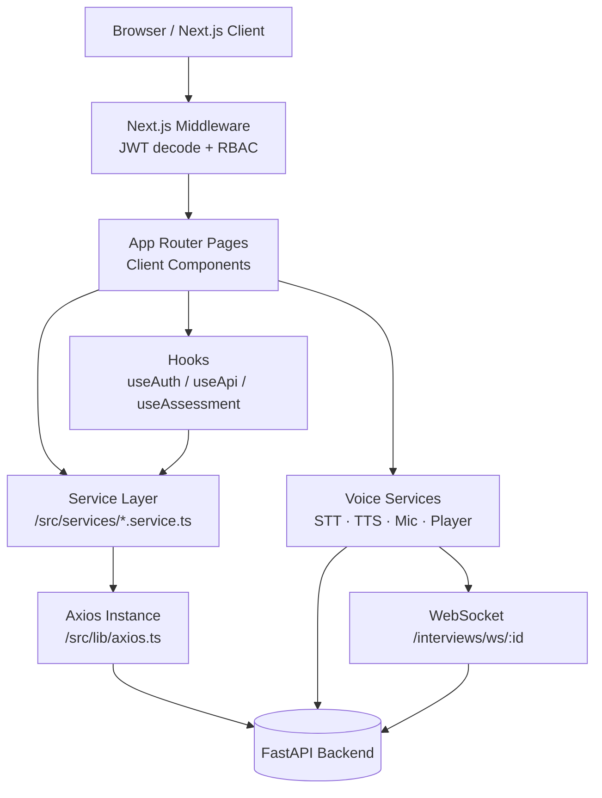
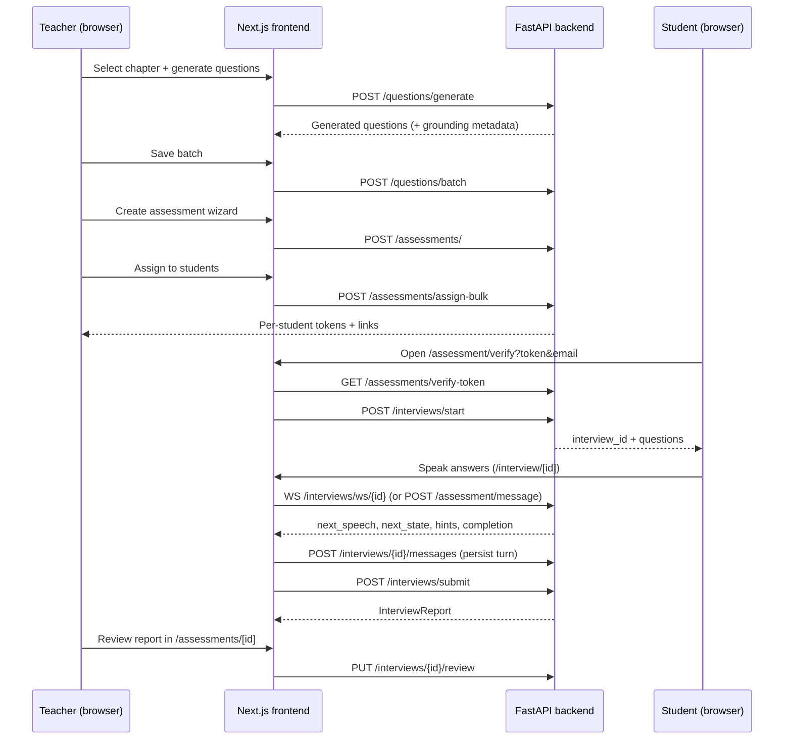

# Momentum / Proctors Frontend — Technical Documentation

> Comprehensive guide to the repository: what it is, how it is organized, how it works, and where to change things.

**Repository:** `proctors-in/proctors-frontend`
**Framework:** Next.js 16 (App Router) · React 19 · TypeScript
**Backend:** External FastAPI service (default `http://localhost:5001/api`)

---

## Table of Contents

1. [What This Repository Is](#1-what-this-repository-is)
2. [Technology Stack](#2-technology-stack)
3. [Getting Started](#3-getting-started)
4. [High-Level Architecture](#4-high-level-architecture)
5. [Folder Structure](#5-folder-structure)
6. [Routing Map](#6-routing-map)
7. [Layouts and the App Shell](#7-layouts-and-the-app-shell)
8. [Authentication and Authorization](#8-authentication-and-authorization)
9. [Data Layer: API Client, Services, Types, Validation](#9-data-layer)
10. [State Management and Data Fetching Pattern](#10-state-management-and-data-fetching-pattern)
11. [UI Component System](#11-ui-component-system)
12. [End-to-End User Flows](#12-end-to-end-user-flows)
13. [The Voice Interview Engine](#13-the-voice-interview-engine)
14. [Styling and Design System](#14-styling-and-design-system)
15. [Backend API Reference Used by the Frontend](#15-backend-api-reference-used-by-the-frontend)
16. [Build, Lint, and Deployment](#16-build-lint-and-deployment)
17. [Conventions, Gotchas, and Known Gaps](#17-conventions-gotchas-and-known-gaps)
18. [Related Documents](#18-related-documents)

---

## 1. What This Repository Is

This is the **web frontend** for an educational assessment platform (branded **Momentum**, repo/org renamed toward **Proctors**). It is a school-facing SaaS client that serves three kinds of users:

| Audience | What they do here |
| --- | --- |
| **Super Admin** (platform operator) | Onboard schools/tenants, view system diagnostics, AI token usage, transcripts, errors. |
| **Director / Admin / Teacher** (school staff) | Manage the academic hierarchy (classes → subjects → chapters), build/generate question banks, create and assign assessments, review student reports, manage faculty and permissions. |
| **Student** (via secure link) | Join an assessment with a one-time token, take a voice-driven/oral assessment with the "Buddy" avatar, and view results. |

The frontend is **API-first**: it owns no database and no server-side business logic. All state is fetched from an external FastAPI backend. The only server-side code is Next.js middleware for route gating.

### Product surface at a glance

- Marketing landing page and sign-up onboarding
- Split-pane admin console with collapsible sidebar
- Curriculum management (classes, subjects, chapters, textbook content)
- AI-assisted question generation grounded in chapter content
- Assessment builder and bulk student assignment
- Student voice interview portal (speech-to-text + text-to-speech)
- Learning insights, student journey dashboards, parent summaries
- Super-admin control panel and school settings

---

## 2. Technology Stack

### Runtime and framework

| Package | Version | Role |
| --- | --- | --- |
| `next` | `16.2.6` | App Router, routing, middleware, builds |
| `react`, `react-dom` | `19.2.4` | UI runtime |
| `typescript` | `^5` | Type safety (strict mode, `@/*` path alias) |

### Libraries

| Package | Role |
| --- | --- |
| `axios` | HTTP client with request interceptor for bearer tokens |
| `lenis` | Smooth scrolling on the marketing/landing experience |
| `lucide-react` | Icon set used on the landing page |
| `tailwindcss` `3.4.x` | Utility classes (limited; most styling is CSS variables + inline styles) |
| `eslint` + `eslint-config-next` | Linting (`core-web-vitals` + TypeScript rules) |

### Browser APIs used directly

- **MediaDevices / MediaRecorder** — microphone capture
- **Web Speech API** (`SpeechRecognition`, `speechSynthesis`) — fallback STT/TTS
- **WebSocket** — real-time interview turn execution
- **localStorage / sessionStorage / document.cookie** — token, user session, interview recovery state
- **IntersectionObserver** — landing-page animations and control-panel infinite scroll

### Backend expectations

The frontend expects a FastAPI-style backend that returns JSON, uses JWT bearer auth, and exposes REST endpoints under `/api`. See [Section 15](#15-backend-api-reference-used-by-the-frontend). A separate backend repository provides:

- PostgreSQL/SQLAlchemy persistence
- Celery + Redis background jobs
- Whisper (STT), Kokoro (TTS), and LLM providers (Groq/OpenAI/Gemini)

---

## 3. Getting Started

### Prerequisites

- **Node.js 20+** (Next.js 16 requirement; the Docker runner stage currently uses Node 18 — see [Known Gaps](#17-conventions-gotchas-and-known-gaps))
- `npm` (a `package-lock.json` is committed)
- A running backend API

### Setup

```bash
# 1. Install dependencies
npm install

# 2. Configure environment
cp .env.example .env.local
# edit .env.local if your backend is not at http://localhost:5001/api

# 3. Run the dev server
npm run dev
# → http://localhost:3000
```

### Environment variables

| Variable | Required | Default | Purpose |
| --- | --- | --- | --- |
| `NEXT_PUBLIC_API_URL` | Recommended | `http://localhost:5001/api` | Base URL for all backend requests. `NEXT_PUBLIC_*` is embedded into the client bundle. |

If unset, `src/utils/constants.ts` falls back to `http://<current-hostname>:5001/api` (except on `localhost`/`127.0.0.1`, where it uses `http://localhost:5001/api`). This allows LAN access during development.

### Scripts

| Command | Description |
| --- | --- |
| `npm run dev` | Start Next.js dev server with hot reload |
| `npm run build` | Production build |
| `npm run start` | Serve the production build |
| `npm run lint` | Run ESLint |

> Note: `lint` is defined as `eslint` (no path), so it lints the current directory tree using `eslint.config.mjs`.

### Docker

`Dockerfile` is a two-stage build:

1. **builder** (`node:20-alpine`) — `npm ci`, copy source, `npm run build`
2. **runner** (`node:18-alpine`) — copies `.next`, `public`, `node_modules`, `package*.json`, exposes `3000`, runs `npm run start`

```bash
docker build -t proctors-frontend .
docker run -p 3000:3000 -e NEXT_PUBLIC_API_URL=http://host.docker.internal:5001/api proctors-frontend
```

> `NEXT_PUBLIC_API_URL` is baked in at **build time**, not runtime. Pass it as a build arg/environment during `docker build` if the production API URL differs.

---

## 4. High-Level Architecture



Key architectural characteristics:

- **Client-heavy rendering.** Nearly every interactive page is a `"use client"` component. Only layouts, the root layout, and a few thin page wrappers are server components.
- **Service layer abstraction.** Components never call Axios directly (except file uploads in `student.service.ts`). They call domain services that return unwrapped `response.data`.
- **Central auth token injection.** `src/lib/axios.ts` reads `localStorage.token` and attaches `Authorization: Bearer <token>` to every request.
- **Dual auth storage.** On login the token is written to both `localStorage` (for Axios) and a `token` cookie (for middleware, which runs on the Edge and cannot read localStorage).
- **Route groups without URL segments.** `(admin)` and `(student)` group routes by layout, not by path.
- **Session recovery.** The interview flow persists progress in `sessionStorage` and rehydrates from the backend, so a refresh does not lose a live assessment.

---

## 5. Folder Structure

```text
proctors-frontend/
├── .env.example                 # Environment template (backend URL)
├── .env.local                   # Local overrides (git-ignored)
├── AGENTS.md                    # AI-agent rules (read Next.js docs before coding)
├── CLAUDE.md                    # Pointer for Claude-based tooling
├── Dockerfile                   # Multi-stage production image
├── eslint.config.mjs            # Flat ESLint config (Next core-web-vitals + TS)
├── next.config.ts               # Next.js config (currently empty)
├── package.json                 # Scripts and dependencies
├── postcss.config.mjs           # Tailwind + Autoprefixer
├── tailwind.config.ts           # Theme tokens, fonts, custom colors
├── tsconfig.json                # Strict TS, `@/*` → `./src/*`
├── README.md                    # Short project entry point
├── ONBOARDING.md                # Developer setup guide (Linux/Ubuntu)
├── PRODUCT_DOCUMENTATION.md     # Full product/feature catalog
├── INTERVIEW_SYSTEM.md          # Voice interview + AI evaluation architecture
├── DOCUMENTATION.md             # ← this file
│
├── public/                      # Static assets
│   ├── logo.png                 # App logo (also large root-level copy)
│   ├── momentum-logo.{png,svg,xml}
│   ├── favicon.ico
│   ├── screenshots/             # Landing-page imagery
│   ├── video_placeholder_files/ # Demo video + supporting chunks
│   └── video_placeholder.html
│
└── src/
    ├── middleware.ts            # Edge JWT gate + role/feature routing
    │
    ├── app/                     # App Router
    │   ├── layout.tsx           # Root layout: metadata, loader, Lenis
    │   ├── globals.css          # ~1,680-line design system + utility CSS
    │   ├── page.tsx             # Marketing landing page
    │   ├── login/page.tsx       # Split-screen login
    │   ├── signup/page.tsx      # 3-step school onboarding
    │   ├── unauthorized/page.tsx
    │   │
    │   ├── (admin)/             # Admin console route group
    │   │   ├── layout.tsx       # → AdminLayout (sidebar + navbar)
    │   │   ├── dashboard/
    │   │   ├── syllabus/
    │   │   ├── classes/
    │   │   ├── subjects/
    │   │   ├── chapters/        # list + [id] reader/generator
    │   │   ├── questions/       # redirects into /assessments tabs
    │   │   ├── assessments/     # list + [id] detail workspace
    │   │   ├── students/        # directory + journey dashboard
    │   │   ├── reports/         # insights + [id] report detail
    │   │   ├── team/
    │   │   ├── school-settings/
    │   │   └── control-panel/
    │   │
    │   ├── (student)/           # Student portal route group
    │   │   ├── layout.tsx       # → StudentLayout (slim header/footer)
    │   │   ├── assessment/join/
    │   │   ├── assessment/verify/
    │   │   ├── assessment/[sessionId]/
    │   │   └── result/[id]/
    │   │
    │   └── interview/           # Standalone voice interview flow
    │       ├── page.tsx         # Empty placeholder
    │       ├── [interviewId]/page.tsx         # Voice assessment UI
    │       └── [interviewId]/result/page.tsx  # Interview report
    │
    ├── components/
    │   ├── layout/              # AdminLayout, StudentLayout, Navbar, Sidebar
    │   ├── common/              # Button, Input, Modal, Loader, PageHeader…
    │   ├── cards/               # AssessmentCard, QuestionCard, ReportCard, StatCard
    │   ├── forms/               # Create/edit forms, wizards, modals
    │   ├── tables/              # Classes, Subjects, Chapters, Questions, Assessments
    │   ├── team/                # TeamSettings (faculty + permissions)
    │   ├── student/             # In-assessment UI (progress, stepper, result)
    │   └── students/            # Journey analytics cards and charts
    │
    ├── hooks/
    │   ├── useApi.ts            # Generic async wrapper (data/loading/error)
    │   ├── useAuth.ts           # Login/logout/current-user
    │   └── useAssessment.ts     # Legacy MCQ session hook (timer + submit)
    │
    ├── lib/
    │   ├── axios.ts             # Configured Axios instance + interceptor
    │   └── auth.ts              # JWT decode/expiry helpers
    │
    ├── services/
    │   ├── api.ts               # Thin typed wrapper over Axios
    │   ├── auth.service.ts
    │   ├── assessment.service.ts
    │   ├── interview.service.ts
    │   ├── question.service.ts
    │   ├── chapter.service.ts
    │   ├── class.service.ts
    │   ├── subject.service.ts
    │   ├── student.service.ts
    │   ├── report.service.ts
    │   ├── dashboard.service.ts
    │   ├── controlPanel.service.ts
    │   ├── team.service.ts
    │   └── voice/               # Voice subsystem
    │       ├── index.ts
    │       ├── types.ts
    │       ├── microphone.service.ts
    │       ├── player.service.ts
    │       ├── stt.service.ts
    │       ├── tts.service.ts
    │       └── voice.service.ts
    │
    ├── types/                   # Domain TypeScript interfaces
    │   ├── assessment.types.ts
    │   ├── auth.types.ts
    │   ├── chapter.types.ts
    │   ├── class.types.ts
    │   ├── question.types.ts
    │   ├── report.types.ts
    │   ├── student.types.ts
    │   └── subject.types.ts
    │
    ├── utils/
    │   ├── constants.ts         # API base URL, storage keys, roles, Bloom levels
    │   ├── formatters.ts        # Duration/date/percentage formatting
    │   ├── helpers.ts           # Errors, Hindi detection, shuffling, debounce
    │   └── storage.ts           # Safe localStorage wrapper
    │
    └── validations/             # Lightweight schema-style validators
        ├── assessment.schema.ts
        ├── auth.schema.ts
        ├── chapter.schema.ts
        ├── class.schema.ts
        ├── question.schema.ts
        └── subject.schema.ts
```

### Why the large page files?

Several pages (`assessments/[id]`, `CreateAssessmentModal`, `syllabus`, `students`, `dashboard`, `interview/[id]`) are 1,500–2,500 lines. They intentionally co-locate data loading, derived state, and tabbed sub-views. When refactoring, prefer extracting presentational subcomponents (already the pattern under `components/students/`) rather than restructuring routing.

---

## 6. Routing Map

Route groups in parentheses **do not appear in the URL**.

### Public routes

| URL | File | Purpose |
| --- | --- | --- |
| `/` | `src/app/page.tsx` | Marketing landing page (hero, features, video, FAQ) |
| `/login` | `src/app/login/page.tsx` | Email/password login |
| `/signup` | `src/app/signup/page.tsx` | School onboarding wizard |
| `/unauthorized` | `src/app/unauthorized/page.tsx` | RBAC denial page |

### Admin console (`(admin)` group → `AdminLayout`)

| URL | File | Purpose |
| --- | --- | --- |
| `/dashboard` | `(admin)/dashboard/page.tsx` | Role-aware home: teacher dashboard, director stats, or super-admin school registry/diagnostics |
| `/syllabus` | `(admin)/syllabus/page.tsx` | Curriculum browser: classes → subjects → chapters, inline create/edit |
| `/classes` | `(admin)/classes/page.tsx` | Class list + create modal |
| `/subjects` | `(admin)/subjects/page.tsx` | Subject list + create modal |
| `/chapters` | `(admin)/chapters/page.tsx` | Chapter list + create modal |
| `/chapters/[id]` | `(admin)/chapters/[id]/page.tsx` | Chapter reader, section assets, AI question generation drawer, assessment creation |
| `/questions` | `(admin)/questions/page.tsx` | Redirects to `/assessments?tab=questions` |
| `/questions/generate` | `(admin)/questions/generate/page.tsx` | Redirects to `/assessments?tab=generate` |
| `/assessments` | `(admin)/assessments/page.tsx` | Tabbed workspace: assessments, question library, AI generation |
| `/assessments/[id]` | `(admin)/assessments/[id]/page.tsx` | Assessment detail: overview, questions, students, progress, insights |
| `/students` | `(admin)/students/page.tsx` | Student directory, class filtering, individual journey dashboard |
| `/reports` | `(admin)/reports/page.tsx` | Learning insights overview |
| `/reports/[id]` | `(admin)/reports/[id]/page.tsx` | Report/interview detail |
| `/team` | `(admin)/team/page.tsx` | Faculty management + per-feature permissions |
| `/school-settings` | `(admin)/school-settings/page.tsx` | School name, tenant ID, academic year, scholar ID system |
| `/control-panel` | `(admin)/control-panel/page.tsx` | Super-admin diagnostics, schools registry, token usage, transcripts, errors |

### Student portal (`(student)` group → `StudentLayout`)

| URL | File | Purpose |
| --- | --- | --- |
| `/assessment/join?id=<assessmentId>` | `(student)/assessment/join/page.tsx` | Join by scholar number + name |
| `/assessment/verify?token=…&email=…` | `(student)/assessment/verify/page.tsx` | Validate emailed one-time token, start interview |
| `/assessment/[sessionId]` | `(student)/assessment/[sessionId]/page.tsx` | Legacy MCQ assessment session |
| `/result/[id]` | `(student)/result/[id]/page.tsx` | Written result summary |

### Voice interview (root layout)

| URL | File | Purpose |
| --- | --- | --- |
| `/interview` | `interview/page.tsx` | Placeholder (renders `null`) |
| `/interview/[interviewId]` | `interview/[interviewId]/page.tsx` | Full-screen Buddy voice assessment |
| `/interview/[interviewId]/result` | `interview/[interviewId]/result/page.tsx` | Post-interview skill report |

---

## 7. Layouts and the App Shell

### Root layout — `src/app/layout.tsx`

- Declares metadata (`Momentum | Unified Assessment & Learning Platform`).
- Loads `globals.css` (design tokens and utility classes).
- Wraps every route in `PageLoader`, which shows a branded loading overlay for **4 seconds** on initial mount, then reveals the app.
- Wraps everything in `SmoothScrollProvider` (Lenis smooth scrolling).

### Admin layout — `AdminLayout`

```
┌──────────┬──────────────────────────────┐
│ Sidebar  │ Navbar (breadcrumb/user)     │
│ (icon or ├──────────────────────────────┤
│ expanded)│ main.admin-content-area      │
└──────────┴──────────────────────────────┘
```

- `Sidebar` collapses to icons and expands on hover; on mobile it becomes an overlay drawer.
- `Navbar` reads the user from `localStorage`, derives the role title, and handles logout (clears storage, expires the cookie, routes to `/login`).
- Navigation is **permission-aware** (`isAllowed`, `showTeamSettings`, `showSchoolSettings`):
  - Super Admin (`role === "admin"` and no `tenantId`) sees **Control Panel**; the assessments/students/reports links are hidden and the dashboard switches to the platform view.
  - Director sees **Team** and **Settings**.
  - Teachers see only features listed in `allowed_features`.

### Student layout — `StudentLayout`

Minimal branded header ("Momentum Student Portal"), content area, and footer. Used for join/verify/MCQ/result routes, but **not** for `/interview/*`, which uses the root layout and renders its own full-screen UI.

---

## 8. Authentication and Authorization

### 8.1 Login flow

1. `LoginForm` posts credentials to `POST /auth/login`.
2. Response shape: `{ token: string, user: User }`.
3. The token is stored in:
   - `localStorage.token` — read by the Axios interceptor.
   - `localStorage.user_session` — read by sidebar/navbar for display and permissions.
   - `document.cookie: token=…; path=/; max-age=86400; SameSite=Lax` — read by middleware.
4. Router pushes to `/dashboard`.

Logout reverses this: removes the two localStorage keys, expires the cookie, and redirects.

### 8.2 JWT handling

`src/lib/auth.ts` provides `isTokenValid` and `getUserFromToken`. Both decode the JWT payload with `atob` (no signature verification). `middleware.ts` implements its own base64url-safe decoder so it works in the Edge runtime.

The JWT payload is expected to contain at least:

```jsonc
{
  "sub": "user-id",
  "role": "admin | director | teacher | student",
  "tenant_id": "…" | null,
  "allowed_features": ["dashboard", "classes", "…"]
}
```

### 8.3 Middleware gate — `src/middleware.ts`

Runs on the Edge for the matcher routes. It performs **coarse routing**, not cryptographic verification:

1. **No token + dashboard route** → redirect to `/login`.
2. **`/team`** → only Super Admin (`admin` + no `tenant_id`) or `director`.
3. **Feature permissions** (for non-super-admin, non-director):
   - Maps the path prefix to a feature key (`dashboard`, `classes`, `subjects`, `chapters`, `questions`, `assessments`, `reports`, `students`).
   - If `allowed_features` does not contain the key → redirect to `/unauthorized`.
   - `/assessments` is allowed if the user has either `assessments` **or** `questions`.
4. Student routes are matched but currently only the dashboard-token rule applies.

> Matcher caveat: `/syllabus`, `/control-panel`, and `/school-settings` are **not** in the middleware matcher, and student routes are not redirected to login when no token exists. Those pages rely on their own client-side guards/API failures. Treat middleware as UX gating, not a security boundary — the backend must enforce authorization.

### 8.4 Roles in the UI

| Role | Detection | Experience |
| --- | --- | --- |
| **Super Admin** | `role === "admin" && !tenantId` | Control Panel, platform dashboard, school registry |
| **Director** | `role === "director"` | Full school console, Team, Settings |
| **Admin (tenant)** | `role === "admin"` with `tenantId` | School console scoped to tenant |
| **Teacher** | `role === "teacher"` | Feature-gated console via `allowed_features` |
| **Student** | Public token or join flow | Student portal / interview |

---

## 9. Data Layer

### 9.1 Axios instance — `src/lib/axios.ts`

```ts
axios.create({
  baseURL: API_BASE_URL,          // NEXT_PUBLIC_API_URL
  headers: { "Content-Type": "application/json" },
  timeout: 10000,                 // 10 seconds
});
```

A request interceptor adds `Authorization: Bearer <localStorage.token>` in the browser. There is **no response interceptor**; expired-token handling is done ad hoc per page.

### 9.2 Typed API wrapper — `src/services/api.ts`

`api.get/post/put/delete<T>` returns `response.data` directly, so service methods resolve to domain objects rather than Axios responses. Form-data uploads bypass this wrapper and use `apiClient` directly to control the `multipart/form-data` header.

### 9.3 Domain services

| Service | Responsibility | Endpoint prefix |
| --- | --- | --- |
| `auth.service` | Login, signup, logout, current user | `/auth` |
| `class.service` | CRUD classes | `/classes` |
| `subject.service` | CRUD subjects (optionally filtered by class) | `/subjects` |
| `chapter.service` | CRUD chapters, PDF/plain-text parse, NCERT sync | `/chapters` |
| `question.service` | List, create, delete, AI generate, batch save | `/questions` |
| `assessment.service` | CRUD, start/submit sessions, assign/bulk assign, token verify, join | `/assessments` |
| `interview.service` | Start/submit/report, transcript messages, session state, real-time turns, review/regenerate | `/interviews`, `/assessment/message` |
| `student.service` | CRUD, results, journey, Excel uploads, picture upload | `/students` |
| `report.service` | Overview, report by id, class report | `/reports` |
| `dashboard.service` | Aggregated stats | `/dashboard` |
| `controlPanel.service` | Diagnostics, schools CRUD, school settings | `/control-panel` |
| `team.service` | Faculty CRUD + permissions | `/team` |
| `voice/*` | Microphone, recording, browser/API STT, browser/API TTS, audio playback | `/voice` |

### 9.4 Types

`src/types/*.types.ts` mirrors backend payloads. Notable shapes:

- `AssessmentData` — id, title, subject/class, question count, status, assignments.
- `StudentAssignmentData` — per-student token, expiry, session status, linked interview score.
- `ChapterData` — id, number, title, subject, content, optional `bookChapter` with `sections` and `assets`.
- `QuestionData` — text, options, difficulty, cognitive level, AI grounding metadata (`source`, `section`, `page`, `confidence`, `referenceText`).
- `InterviewReport` — overall score, grade, recommendation, four subscores, strengths/improvements, transcript, evaluated answers, evaluation steps, review state.
- `StudentJourneyData` — parent summary, strengths, subject mastery, timeline, trend data, achievements.

### 9.5 Validations

`src/validations/*.schema.ts` are **not** Zod/Yup schemas. Each exports a plain object with a `validateX(data)` function returning `{ success, errors }`. They are used opportunistically in forms; most forms do inline validation and rely on backend 422 errors surfaced by `extractErrorMessage`.

### 9.6 Error handling

`extractErrorMessage(err, fallback)` in `src/utils/helpers.ts` understands FastAPI error shapes:

- `detail` as a string
- `detail` as an array of validation objects (`loc`, `msg`, `type`)
- `detail` as an object
- `message` / `error` string fields
- Axios `err.message`
- raw string errors

This is the standard way to display API errors across the app.

---

## 10. State Management and Data Fetching Pattern

There is **no global state library** (no Redux, Zustand, React Query).

### Patterns used

1. **Local page state + `useEffect`**
   ```tsx
   const [data, setData] = useState<T[]>([]);
   const [loading, setLoading] = useState(true);
   const [error, setError] = useState("");
   useEffect(() => { /* fetch */ }, []);
   ```
   This is the dominant pattern, often with `Promise.all` for parallel fetches.

2. **`useApi` hook** — a small wrapper for imperative calls:
   ```ts
   const { data, loading, error, execute, setData } = useApi(questionService.getAll);
   ```
   Returns data, loading, error, and rethrows so callers can handle failures.

3. **`useAuth` hook** — loads the current user from `/auth/me` if a token exists; otherwise clears invalid tokens.

4. **`useAssessment` hook** — legacy MCQ helper with a 30-minute countdown and submit-on-timeout. The current voice interview flow does **not** use it.

5. **URL as state** — tabs and filters are often stored in query params (`?tab=questions`, `?classId=…`, `?studentId=…`) so links and refreshes preserve context.

6. **Session persistence** — interview progress uses:
   - `sessionStorage["interview_session_<id>"]` — student name, questions, chapter metadata
   - `sessionStorage["interview_report_<id>"]` — cached report
   - Backend progressive state via `/interviews/{id}/session`

7. **Cross-tab user sync** — Sidebar and Navbar listen to the `storage` event to update when another tab logs in/out.

---

## 11. UI Component System

All components are function components. Client components declare `"use client"`; layouts are server components.

### `components/layout/`

| Component | Notes |
| --- | --- |
| `AdminLayout` | Sidebar + Navbar shell, mobile overlay state |
| `Sidebar` | Collapsible, hover-expand, permission-filtered nav, profile card, logout |
| `Navbar` | Breadcrumb/title, user dropdown, role label, logout |
| `StudentLayout` | Minimal student header/footer |

### `components/common/`

`Button`, `Input`, `Modal`, `ConfirmDialog`, `EmptyState`, `Loader`, `LogoLoader`, `PageLoader`, `PageHeader`, `SmoothScrollProvider`.

These are mostly presentational wrappers with inline style objects. `LogoLoader` is the branded animated loader; `PageLoader` gates the app for 4 seconds.

### `components/cards/`

`AssessmentCard`, `QuestionCard`, `ReportCard` (large, tabbed report renderer), `StatCard`.

### `components/forms/`

| Form | Purpose |
| --- | --- |
| `LoginForm` | Auth + token/cookie persistence |
| `ClassForm` | Create class |
| `SubjectForm` | Create subject linked to a class |
| `ChapterForm` | Create chapter; supports file upload → `/chapters/parse-file` |
| `QuestionGeneratorForm` | AI question generation with class/subject/chapter/cognitive filters; batch save; creates assessments |
| `CreateAssessmentModal` | Multi-step wizard: curriculum → preparing → review → assignment → success |
| `CreateAndAssignModal` | Create assessment from generated questions and assign |
| `AssignAssessmentModal` | Pick students and bulk assign |
| `ViewAssignmentsModal` | List per-student tokens/status; copy secure links |
| `StudentAnswerForm` | MCQ options or free-text answer |
| `StudentReportModal` | Interview report viewer/reviewer |

### `components/tables/`

`ClassesTable`, `SubjectsTable`, `ChaptersTable`, `QuestionsTable`, `AssessmentsTable` — each handles fetching, filtering, sorting, pagination, and row actions. `QuestionsTable` additionally groups questions by generation "session".

### `components/student/` vs `components/students/`

- `student/` = **during/monitoring an assessment**: `ProgressTracker`, `QuestionStepper`, `ResultSummary`.
- `students/` = **analytics dashboards**: `LearningJourneyTimeline`, `LearningTrendChart`, `ParentSummaryCard`, `SubjectMasteryCard`, `TeacherNotesPanel`.

### `components/team/`

`TeamSettings` — faculty table, add/edit modal, role selection, and per-feature permission checkboxes (`dashboard`, `classes`, `subjects`, `chapters`, `questions`, `assessments`, `reports`, `students`).

---

## 12. End-to-End User Flows

### 12.1 School onboarding (signup)

`/signup` is a 3-step wizard:

1. **School Identity** — name, type, student count (UI inputs).
2. **Director Account** — name, email, password (+ confirmation).
3. Calls `POST /auth/signup` with `{ name, email, password, schoolName }`, then `POST /auth/login` to auto-authenticate and persist the token/cookie.
4. **Success** — displays the generated tenant ID for the user to save (auto-redirects to `/dashboard` after 15 seconds).

### 12.2 Curriculum management

```
Syllabus UI
  └─ Class  (grade + section)
       └─ Subject  (name, code, class)
            └─ Chapter  (number, title, subject, content)
                 └─ BookChapter → Sections → Assets   (after NCERT sync)
```

- Classes/subjects/chapters can be created from list pages or the unified `/syllabus` page.
- Chapter creation supports uploading a file; `chapterService.parseFile` posts to `/chapters/parse-file` and fills the chapter content.
- `chapterService.syncNcert(id)` triggers backend ingestion of official NCERT textbook content. `(admin)/chapters/[id]` renders sections, images, and lets teachers generate questions from selected sections.

### 12.3 AI question generation

From the **Assessments → Generate** tab or a chapter's generation drawer:

1. Select class, subject, chapter (and optionally a specific text selection).
2. Choose difficulty, Bloom's cognitive level, question count, and type.
3. `questionService.generateAIQuestions` → `POST /questions/generate`.
4. Review generated items with grounding metadata (`source`, `section`, `page`, `confidence`, `reference_text`).
5. Save via `POST /questions/batch` (optionally clearing existing questions for that chapter/session).
6. Optionally create an assessment from the generated batch (`CreateAndAssignModal`).

### 12.4 Assessment creation and assignment

`CreateAssessmentModal` wizard:

1. **Curriculum** — title, class, subject, questions to ask.
2. **Preparing** — fetch/select questions.
3. **Review** — inspect the question set.
4. **Assignment** — select individual students or a class.
5. **Success** — displays created assessment and assignment status.

Assignment endpoints:

- Single: `POST /assessments/assign`
- Bulk: `POST /assessments/assign-bulk`

Each student receives a unique token and an emailed link of the form:

```
/assessment/verify?token=<uuid>&email=<encoded email>
```

Teachers can copy links from `ViewAssignmentsModal`.

### 12.5 Student assessment entry (two paths)

**Emailed token path**

```
/assessment/verify?token&email
   → GET /assessments/verify-token
   → POST /interviews/start {token, email}
   → sessionStorage["interview_session_<id>"]
   → router → /interview/<interviewId>
```

**Classroom join path**

```
/assessment/join?id=<assessmentId>
   → GET /assessments/<id>/join-info
   → student enters scholar number + name
   → POST /assessments/join-verify  (returns the student's assignment token)
   → redirect to /assessment/verify?token=…&email=…
   → (same token flow as above)
```

### 12.6 During the interview ("Buddy")

`/interview/[interviewId]` is a full-screen, state-driven experience:

```
loading → meet_buddy → device_setup → comfort_conv → transition → interview → generating → completed
```

- **Device setup** requires both microphone and camera permission; the assessment cannot start otherwise. A camera preview is shown.
- **Comfort conversation** warms up the student (0 = "How are you?", 1 = "What did you enjoy?", 2 = "Ready?").
- **Interview** loops through questions, speaks each via TTS, listens via STT, submits turns, offers hints/follow-ups based on backend state, and tracks progress.
- **Silence handling** nudges the student and auto-skips after repeated silence.
- **Offline handling** listens to `online`/`offline` events and falls back to HTTP if the WebSocket is unavailable.
- **Recovery** rehydrates from `sessionStorage` and `/interviews/{id}` if the page is refreshed.
- On completion it fetches the report and routes to `/interview/[id]/result`.

### 12.7 Teacher review and insights

- `/assessments/[id]` aggregates per-student assignments and interview reports across tabs (overview/questions/students/progress/insights).
- Teachers can open a student's report, add observation notes (`PUT /interviews/{id}/notes`), review/override evaluated answers (`PUT /interviews/{id}/review`), and regenerate an evaluation (`POST /interviews/{id}/regenerate`).
- `/students` provides a class directory plus an individual journey: parent summary, strengths, improvement areas, subject mastery, timeline, trend chart, teacher notes.
- `/reports` provides school-wide overview stats and class/subject filters; `/reports/[id]` shows a specific written report or falls back to the assessment's interview reports.

### 12.8 Super Admin

- `/dashboard` renders a platform view for `admin` + no tenant: school registry and diagnostics entry points.
- `/control-panel` shows system diagnostics (`/control-panel/diagnostics`), AI token usage, active pipelines, model status, transcripts (with infinite scroll), and error logs. It also allows onboarding/deleting schools (`/control-panel/schools`).
- `/school-settings` reads/updates school settings (`/control-panel/school-settings`) — currently focused on the school name, with tenant/academic metadata shown.

---

## 13. The Voice Interview Engine

Located at `src/services/voice/`. It is a self-contained subsystem with clean interfaces.

### Components

| File | Responsibility |
| --- | --- |
| `types.ts` | `VoiceEngineConfig`, state machine states, callback contracts |
| `microphone.service.ts` | Permission request, `getUserMedia`, audio level analyser, level subscribers |
| `player.service.ts` | HTML5 `Audio` wrapper for URL/Blob playback with start/end/error/progress callbacks |
| `stt.service.ts` | `BrowserSTTService` (Web Speech API) and API/Whisper recording path (`MediaRecorder` → `POST /voice/transcribe`) |
| `tts.service.ts` | `BrowserTTSService` (`speechSynthesis`) and API/Kokoro path (`POST /voice/speak` → audio blob → player) |
| `voice.service.ts` | Facade that initializes, exposes state, speaks, listens, cancels, and broadcasts levels |

### Current configuration

`VoiceService.initialize()` currently forces **browser** providers:

```ts
finalConfig.sttProvider = "browser";
finalConfig.ttsProvider = "browser";
```

So the interview runs on the browser's native Web Speech API in practice. The API/Whisper and API/Kokoro code paths remain implemented for future use/backends.

### Turn-taking and transport

1. Buddy speaks a question via TTS.
2. Microphone opens; browser STT finalizes a transcript.
3. The turn is sent over **WebSocket** `/interviews/ws/{interviewId}`.
4. If the socket is closed/errors, the app falls back to HTTP `POST /assessment/message` (`interviewService.executeTurn`).
5. The backend response drives the next state, speech, hints/follow-ups, and completion.
6. Every turn is also persisted via `POST /interviews/{id}/messages` and `POST /interviews/{id}/session` for recovery and auditing.

### Browser workarounds

- Chrome's ~15-second speech-synthesis cutoff is handled with a keep-alive pause/resume interval.
- Voices load asynchronously in some browsers; TTS waits for `voiceschanged`.
- Emoji/private-use glyphs are stripped from text before synthesis.
- `MediaRecorder` picks the best supported MIME type (webm/opus → ogg → mp4 → aac).

---

## 14. Styling and Design System

### Approach

Styling is a hybrid:

- **CSS variables + custom classes** in `src/app/globals.css` (~1,680 lines) — the primary system.
- **Inline `style={styles.x}` objects** for component-local layout (many components define a `styles` record at the bottom).
- **Tailwind utilities** for a small subset; `tailwind.config.ts` defines brand tokens.

### Design tokens (in `globals.css`)

| Group | Examples |
| --- | --- |
| Brand | `--primary: #2563EB`, `--secondary`, `--accent: #F59E0B` |
| Semantic | `--success`, `--warning`, `--error`, `--info` (+ light variants) |
| Surfaces | `--bg-app`, `--bg-surface`, `--border-color`, `--divider` |
| Text | `--text-primary`, `--text-secondary`, `--text-muted` |
| Glass | `--glass-bg`, `--glass-border`, `--glass-shadow`, `--glass-backdrop` |
| Radii | `--radius-sm`, `--radius-md`, `--radius-lg` |
| Shadows | `--shadow-sm/md/lg` |
| Motion | `--transition-fast/normal/slow` |

### Typography

- **Inter** — body and UI.
- **Space Grotesk** — display/headline in `tailwind.config.ts`.
- **Noto Sans Devanagari** — Hindi content; `font-hindi` class applied via `isHindiText()` / `getFontClass()`.

### Layout notes

- Light-only theme (dark-mode media query intentionally removed).
- Tailwind `preflight` is disabled (`corePlugins.preflight: false`) because the app ships its own resets.
- Responsive behavior is implemented with custom media queries and CSS classes (`admin-layout-container`, `sidebar-overlay`, `auth-split-container`, etc.).

---

## 15. Backend API Reference Used by the Frontend

Base URL: `${NEXT_PUBLIC_API_URL}` (default `http://localhost:5001/api`). All authenticated requests carry `Authorization: Bearer <token>`.

### Auth

| Method | Path | Used by |
| --- | --- | --- |
| POST | `/auth/login` | LoginForm |
| POST | `/auth/signup` | Signup |
| POST | `/auth/logout` | useAuth |
| GET | `/auth/me` | useAuth |

### Curriculum

| Method | Path | Used by |
| --- | --- | --- |
| GET/POST | `/classes/`, `/classes` | Class list/create |
| GET/PUT/DELETE | `/classes/{id}` | Class detail/update/delete |
| GET/POST | `/subjects/`, `/subjects` | Subject list/create (`?class_id=`) |
| GET/PUT/DELETE | `/subjects/{id}` | Subject detail |
| GET | `/subjects/{id}/chapters` | Chapters by subject |
| GET/POST | `/chapters/`, `/chapters` | Chapter list/create |
| GET/PUT/DELETE | `/chapters/{id}` | Chapter detail |
| POST | `/chapters/parse-file` | Upload file → extracted text |
| POST | `/chapters/{id}/sync-ncert` | NCERT ingestion |

### Questions

| Method | Path | Used by |
| --- | --- | --- |
| GET | `/questions/` | Library (`class_id`, `subject_id`, `chapter_id`, `session`) |
| POST | `/questions/generate` | AI generation |
| POST | `/questions/batch` | Batch save |
| POST | `/questions` | Single create |
| DELETE | `/questions/{id}` | Delete |

### Assessments

| Method | Path | Used by |
| --- | --- | --- |
| GET | `/assessments/` | List |
| GET | `/assessments/{id}` | Detail |
| POST | `/assessments/` | Create |
| POST | `/assessments/{id}/start` | Start session |
| POST | `/assessments/submit` | Submit answers |
| POST | `/assessments/assign` | Single assignment |
| POST | `/assessments/assign-bulk` | Bulk assignment |
| GET | `/assessments/verify-token?token&email` | Token verification |
| POST | `/assessments/start-by-token` | Start from token |
| GET | `/assessments/{id}/join-info` | Join page info |
| POST | `/assessments/join-verify` | Scholar-ID join |

### Interviews

| Method | Path | Used by |
| --- | --- | --- |
| POST | `/interviews/start` | Verify/join → interview |
| POST | `/interviews/submit` | Final submission |
| GET | `/interviews/{id}` | Report / recovery |
| GET | `/interviews/assessment/{assessmentId}` | Reports for assessment |
| PUT | `/interviews/{id}/notes` | Teacher notes |
| POST | `/interviews/{id}/messages` | Per-turn transcript |
| POST | `/interviews/{id}/session` | Progressive session state |
| PUT | `/interviews/{id}/review` | Human review/override |
| POST | `/interviews/{id}/regenerate` | Re-run evaluation |
| POST | `/assessment/message` | HTTP turn fallback |
| WS | `/interviews/ws/{interviewId}` | Real-time turn execution |

### Students, reports, dashboard, team, control panel

| Method | Path | Used by |
| --- | --- | --- |
| GET | `/students/?class_id={id}` | Student directory |
| GET/PUT/DELETE | `/students/{id}` | Profile |
| GET | `/students/{id}/results` | Result history |
| GET | `/students/{id}/journey` | Journey dashboard |
| POST | `/students/upload-excel` | Bulk import |
| POST | `/students/upload-multiple-sections` | Multi-section import |
| POST | `/students/{id}/picture` | Photo upload |
| GET | `/reports/overview` | Insights overview |
| GET | `/reports/{id}` | Report detail |
| GET | `/reports/class/{classId}` | Class report |
| GET | `/dashboard/stats` | Dashboard aggregates |
| GET/POST | `/team`, `/team` | Faculty list/create |
| PUT/DELETE | `/team/{id}` | Update/delete |
| GET | `/control-panel/diagnostics` | System diagnostics |
| GET/POST | `/control-panel/schools` | School registry |
| DELETE | `/control-panel/schools/{id}` | Remove school |
| GET/PUT | `/control-panel/school-settings` | School settings |
| POST | `/voice/transcribe` | API STT (implemented, not active by default) |
| POST | `/voice/speak` | API TTS (implemented, not active by default) |

---

## 16. Build, Lint, and Deployment

### Local production check

```bash
npm run lint
npm run build
npm run start
```

### `next.config.ts`

Currently empty. If you add rewrites/proxy for `/api`, `images` domains, or WebSocket proxying, this is the place.

### `tsconfig.json`

- `strict: true`
- `moduleResolution: "bundler"`
- Path alias `@/*` → `./src/*`
- Includes `.next/types` for generated route types

### Linting

`eslint.config.mjs` uses the flat config format:

- `eslint-config-next/core-web-vitals`
- `eslint-config-next/typescript`
- Ignores `.next/**`, `out/**`, `build/**`, `next-env.d.ts`

### Deployment

- **Vercel**: zero-config; set `NEXT_PUBLIC_API_URL` in project env vars.
- **Docker**: see [Section 3](#3-getting-started). Remember the build-time env inlining.
- **Static export is not supported** as-is because of middleware and dynamic routes.

---

## 17. Conventions, Gotchas, and Known Gaps

### Conventions to follow when contributing

1. **Read the bundled Next.js 16 docs first.** `AGENTS.md` explicitly warns that APIs/conventions differ from older Next.js knowledge. The docs live in `node_modules/next/dist/docs/`.
2. **Use the service layer.** Add new endpoints to a `*.service.ts`, not inline in a component.
3. **Use `extractErrorMessage`** for user-facing API errors.
4. **Preserve role checks.** If you add a nav item, update `Sidebar` visibility and `middleware.ts` matcher/permissions together.
5. **Keep the design tokens.** Prefer existing CSS variables (`--primary`, `--text-secondary`, etc.) over hard-coded colors.
6. **Handle Hindi.** Use `isHindiText` / `font-hindi` for chapter, question, and student-entered content.
7. **Client components need `"use client"`.** Layout wrappers can stay server components.
8. **Be careful with `use(params)`.** This Next.js version passes `params` as a Promise in dynamic pages.

### Known gaps / risks observed in the code

| Area | Observation |
| --- | --- |
| **Client-side auth** | Middleware decodes the JWT but does not verify its signature. Real authorization must be enforced by the backend. |
| **Middleware coverage** | `/syllabus`, `/control-panel`, `/school-settings` are outside the matcher; student routes lack a no-token redirect. |
| **Docker runtime** | Builder uses Node 20, runner uses Node 18. Next.js 16 expects Node 20+; align the runner stage. |
| **No response interceptor** | Expired sessions produce per-page errors instead of a global 401 → login redirect. |
| **No global state/cache** | Repeated fetches across pages; no React Query/SWR caching or deduping. |
| **Landing loader** | `PageLoader` deliberately blocks for 4 seconds on every full load. This is a UX/branding choice but affects perceived performance. |
| **Very large components** | Several 1,500–2,500-line pages; refactoring into subcomponents is advisable before adding major features. |
| **Two answer flows** | Legacy MCQ (`useAssessment`, `/assessment/[sessionId]`, `/result/[id]`) coexists with the voice interview (`/interview/*`). Both should be maintained or the legacy path retired. |
| **Hard-coded defaults** | Some components fall back to placeholder names ("Priya", "Aarav", "Fractions") when data is missing. |
| **No tests** | There is no test runner, test folder, or CI config in this repository. |
| **Permission key casing** | Middleware reads `allowed_features` from the decoded JWT, while the app state (`localStorage.user_session`) and Sidebar/Team UI use `allowedFeatures`. Ensure the backend emits both consistent forms, or nav visibility and route gating can disagree. |
| **Branding drift** | UI text still says "Momentum" while the repo/org is "Proctors"; asset filenames mix both. |

---

## 18. Related Documents

| Document | Contents |
| --- | --- |
| `README.md` | Quick start and repository orientation |
| `ONBOARDING.md` | Step-by-step Linux developer setup |
| `PRODUCT_DOCUMENTATION.md` | Product mission, full feature catalog, database overview, backend integrations |
| `INTERVIEW_SYSTEM.md` | Deep dive into the voice interview state machine, STT/TTS providers, AI evaluation pipeline, and human review |
| `AGENTS.md` | Mandatory rules for AI-assisted changes (read bundled Next.js docs) |

---

## Appendix A — Request Lifecycle Example

Creating and taking an assessment, end to end:



---

## Appendix B — Where to Make Common Changes

| I need to… | Look at |
| --- | --- |
| Change the backend URL | `.env.local` → `NEXT_PUBLIC_API_URL` |
| Add a sidebar item | `components/layout/Sidebar.tsx` + `middleware.ts` matcher/permissions |
| Add an API endpoint | `services/<domain>.service.ts` + `types/<domain>.types.ts` |
| Change colors/fonts | `src/app/globals.css` (`:root`) and `tailwind.config.ts` |
| Change the landing page | `src/app/page.tsx` |
| Change the login experience | `src/app/login/page.tsx`, `components/forms/LoginForm.tsx` |
| Change the interview flow | `src/app/interview/[interviewId]/page.tsx`, `services/interview.service.ts`, `services/voice/*` |
| Change report rendering | `components/cards/ReportCard.tsx`, `components/student/ResultSummary.tsx` |
| Change role/feature gating | `src/middleware.ts`, `components/layout/Sidebar.tsx`, `components/team/TeamSettings.tsx` |
| Add a new admin page | Create under `src/app/(admin)/<route>/page.tsx`; it inherits `AdminLayout` |
| Add a new student page | Create under `src/app/(student)/<route>/page.tsx`; it inherits `StudentLayout` |
